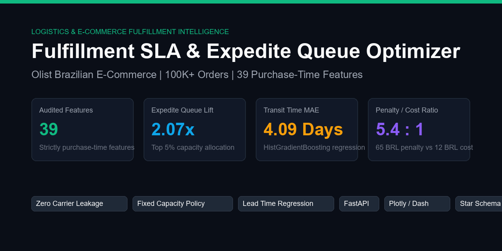
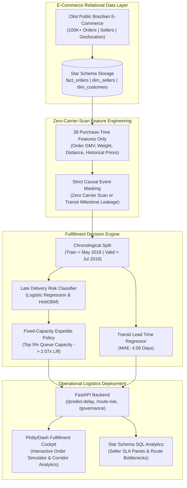

# E-Commerce Fulfillment SLA Intelligence & Expedite Queue Optimizer



[](https://www.python.org/)
[](https://fastapi.tiangolo.com/)
[](https://dash.plotly.com/)
[](https://scikit-learn.org/)
[]()
[]()
[](LICENSE)

---

## 1. Executive Summary

In e-commerce logistics, late delivery risk prediction frequently suffers from subtle post-purchase data leakage, where carrier scan milestones and warehouse handover timestamps are mistakenly used as features.

This platform implements an institutional-grade fulfillment risk intelligence and dispatch optimization system trained on 100,000+ orders across 3,000+ Brazilian sellers from the Olist E-Commerce dataset. Strictly audited to enforce **39 purchase-time features only**, the system drives a **fixed-capacity expedite policy** achieving a **2.07x lift over random dispatch** at the top 5% queue capacity.

```
┌─────────────────────────────────────────────────────────────────────────────┐
│                           HEADLINE METRICS                                  │
├─────────────────────┬─────────────────────┬───────────────────┬─────────────┤
│   Audited Features  │ Expedite Queue Lift │  Transit Time MAE │  Cost Ratio │
│     39 Features     │        2.07x        │     4.09 Days     │   5.4 : 1   │
│(Strict Purchase-Time│ (Top 5% Capacity)   │ (HistGradientBoost│(65 BRL vs   │
│  Zero Carrier Leak) │                     │   Lead Time Model)│   12 BRL)   │
└─────────────────────┴─────────────────────┴───────────────────┴─────────────┘
```

---

## 2. Post-Purchase Carrier Scan Leakage Audit

Standard Kaggle implementations often report >90% precision by incorporating timestamps that occur *after* the customer places their order (e.g., `order_delivered_carrier_date`, intermediate distribution center barcode scans). At checkout time, these events have not happened.

### 39 Purchase-Time Audited Features
- **Order & Basket Physics:** `order_gmv`, `order_weight_g`, `order_volume_cm3`, `order_item_count`, `freight_value`, `freight_ratio`, `freight_per_kg`.
- **Exogenous Geometry & Network:** `distance_km`, `same_state_flag`, `n_shipping_legs`, `Customer_State`, `Seller_State`.
- **Pre-Order Historical Priors:** `seller_prior_orders`, `seller_prior_late_rate`, `route_prior_orders`, `route_prior_late_rate`.
- **Zero Carrier Scan Data:** No post-checkout transit milestones, no warehouse dispatch timestamps, and no carrier tracking tags are permitted.

---

## 3. Fixed-Capacity Expedite Policy & Asymmetric Economics

In an active distribution center, fulfillment managers cannot act on arbitrary probability cutoffs (e.g., "expedite when $P > 0.50$") because air freight contracts and priority handling staff are strictly capacity-constrained.

### Decision Policy Specifications
- **Operating Capacity:** Priority carrier lanes are capped at the top 5.0% highest-risk orders daily.
- **Calibrated Cutoff:** Decision threshold $P(\text{late}) \ge 0.2510$ (isotonic-calibrated probabilities).
- **Queue Efficiency:** Achieves a **2.07x lift over random dispatch**, capturing high-risk long-haul routes while respecting warehouse capacity.
- **Asymmetric Loss Economics:** The business cost of an unmitigated late delivery (65 BRL in compensation, CS ticket handling, and customer churn risk) is 5.4x higher than the cost of preemptive priority freight (12 BRL).

---

## 4. System Architecture



---

## 5. Analytical SQL Layer

The repository provides a relational Star schema and targeted queries:

1. [`sql/queries/01_seller_sla_reliability_pareto.sql`](sql/queries/01_seller_sla_reliability_pareto.sql): Pareto analysis identifying the top 20% of sellers responsible for 80% of fulfillment delays.
2. [`sql/queries/02_geo_logistics_delivery_bottlenecks.sql`](sql/queries/02_geo_logistics_delivery_bottlenecks.sql): Origin-destination corridor matrix classifying route bottleneck risk levels.
3. [`sql/queries/03_post_purchase_leakage_audit.sql`](sql/queries/03_post_purchase_leakage_audit.sql): Causal timestamp ordering audit verifying zero post-purchase information in feature stores.

---

## 6. API Endpoints & Usage

### Health & Governance Check
```bash
curl -X GET "http://127.0.0.1:8057/health"
```
Response:
```json
{
  "status": "healthy",
  "service": "Olist E-Commerce Delivery Analytics",
  "feature_count": 39,
  "leakage_boundary": "Strictly purchase-time features (zero carrier-scan leakage)",
  "lift_at_capacity": 2.07
}
```

### Order Delay Risk & Expedite Dispatch
```bash
curl -X POST "http://127.0.0.1:8057/predict-delay" \
     -H "Content-Type: application/json" \
     -d '{
       "order_gmv": 180.0,
       "order_weight_g": 2500.0,
       "freight_value": 28.5,
       "distance_km": 650.0,
       "same_state_flag": 0,
       "seller_prior_late_rate": 0.08,
       "estimated_delivery_days": 15.0
     }'
```

### Route Bottleneck Risk Lookup
```bash
curl -X POST "http://127.0.0.1:8057/route-risk" \
     -H "Content-Type: application/json" \
     -d '{
       "origin_state": "SP",
       "destination_state": "BA"
     }'
```

---

## 7. Interactive Plotly / Dash Decision Portal

Built with the portfolio Design System (`portfolio_dark` template, responsive cards, Inter typography).

To run locally:
```bash
python frontend/app.py
```
Visit `http://127.0.0.1:8058` to access:
- Interactive order checkout delay risk simulator with live queue status routing.
- Interstate corridor late delivery bottleneck ranking.
- Policy lift curve comparing model prioritization vs random warehouse dispatch.

---

## 8. Repository Structure

```
olist_delivery_analytics/
├── backend/
│   ├── app.py                     # FastAPI delivery risk & corridor microservice
│   └── test_api.py                # Automated pytest suite (4/4 passing)
├── frontend/
│   └── app.py                     # Plotly/Dash decision cockpit (Port 8058)
├── sql/
│   ├── schema.sql                 # Star schema (dim_customers, dim_sellers, fact_orders)
│   └── queries/
│       ├── 01_seller_sla_reliability_pareto.sql
│       ├── 02_geo_logistics_delivery_bottlenecks.sql
│       └── 03_post_purchase_leakage_audit.sql
├── notebooks/
│   ├── 01_eda.ipynb               # Fulfillment funnel exploratory data analysis
│   ├── 02_features.ipynb          # 39 purchase-time feature engineering pipeline
│   ├── 03_modeling.ipynb          # Late delivery classification & duration regression
│   └── 04_evaluation.ipynb        # Chronological validation & policy lift curves
├── docs/
│   ├── REVIEW.md                  # Comprehensive code review & carrier leakage audit
│   ├── EXTENSIONS.md              # Conformal prediction promise dates & dynamic routing
│   ├── architecture.md            # System architecture diagrams
│   ├── github_meta.md             # Repository tags & description
│   ├── linkedin_post.md           # Professional announcement draft
│   └── resume_summary.md          # XYZ-format resume bullet points
├── assets/
│   ├── banner/                    # 1280x640 GitHub banner & wide variant
│   ├── charts/                    # High-resolution PNG & SVG visual outputs
│   ├── poster/                    # Printable A3 executive poster (PNG & PDF)
│   └── social/                    # LinkedIn cover (1200x627)
├── reports/
│   └── figures/                   # Pareto and geospatial delivery visualizations
├── Makefile                       # One-command build, test, and serve recipes
└── requirements.txt               # Locked dependencies
```

---

## 9. Verification & Test Suite

Run unit and integration tests across the backend service:
```bash
pytest backend/test_api.py -v
```
All 4 test cases validate health checks, governance summaries, delay probabilities, and interstate route bottleneck classifications.
