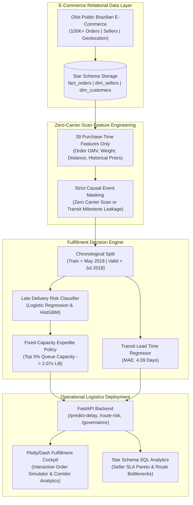

# System Architecture: Olist Delivery Analytics

## Architectural Tenets
1. **Zero Post-Purchase Leakage:** Every feature strictly precedes or coincides with `order_purchase_timestamp`.
2. **Capacity-Constrained Policy:** Dispatch decisions reflect real warehouse expedite bandwidth rather than abstract probability thresholds.
3. **End-to-End Governance:** Chronological splitting mirrors production deployment reality.

